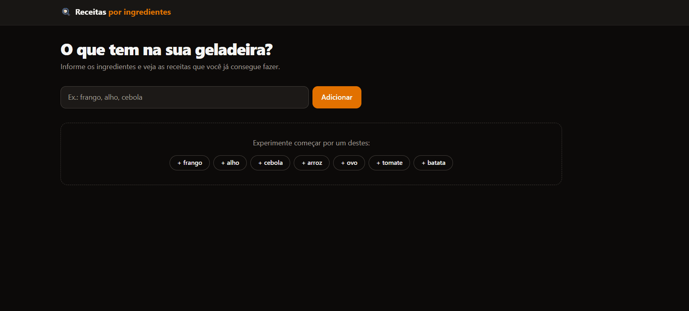
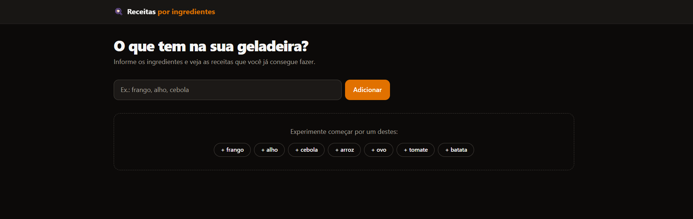
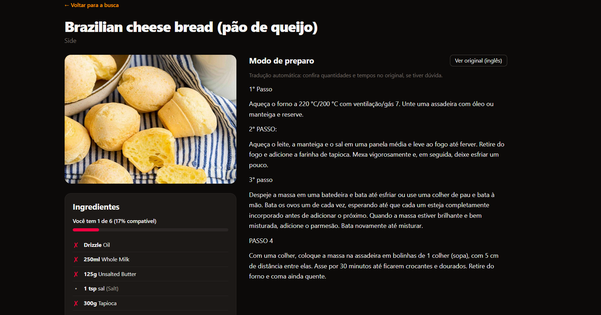

# 🍳 Receitas por ingredientes

[](https://github.com/johnatantech/receitas-app/actions/workflows/ci.yml)

Aplicação full-stack que responde à pergunta *"o que eu consigo cozinhar com o que tenho em casa?"*. Você informa os ingredientes em português e o app mostra receitas **ranqueadas por compatibilidade**, indicando o que você já tem e o que falta.

> **Demo:** https://receitas-app-eta.vercel.app
>
> A API roda em plano gratuito e hiberna após 15 minutos sem uso: a primeira busca pode levar cerca de 1 minuto para responder.



| Busca | Detalhe da receita |
|---|---|
|  |  |

## ✨ Funcionalidades

- **Busca por vários ingredientes** com chips (separa por vírgula ou "e": `frango, alho e cebola`)
- **Ranking por compatibilidade**: porcentagem de ingredientes que você já tem, com a lista do que falta
- **Entrada em português**: dicionário próprio traduz PT→EN para consultar a API e EN→PT para exibir
- **Página de detalhe** com ingredientes marcados (✓ você tem, ✗ falta, • item básico), barra de compatibilidade, modo de preparo e vídeo
- **Modo de preparo traduzido** automaticamente, com botão para ver o original e fallback caso a tradução falhe
- **Busca na URL** (`/?ingredientes=frango,alho`): compartilhável e sobrevive ao F5 e ao botão voltar
- **Tema claro/escuro** automático, layout responsivo, skeleton de carregamento e tratamento de erro

## 🧱 Stack

| Camada | Tecnologias |
|---|---|
| Front-end | React, TypeScript, Vite, TanStack Query, React Router, Tailwind CSS v4 |
| Back-end | ASP.NET Core (.NET 10), Controllers, `HttpClient` tipado, `IMemoryCache` |
| Testes | xUnit |
| APIs externas | [TheMealDB](https://www.themealdb.com/api.php) (receitas), [MyMemory](https://mymemory.translated.net/doc/spec.php) (tradução) |

## 🏗️ Arquitetura

```
Navegador (React)
      │  GET /api/receitas?ingredientes=frango,alho
      ▼
ASP.NET Core API ──► TraducaoService (PT→EN)
      │                    │
      │              MealDbClient ──► TheMealDB   (cache em memória, 6 h)
      │                    │
      │              RankingService (compatibilidade + ordenação)
      │                    │
      │              TraducaoService (EN→PT, só para exibição)
      │
      └─ GET /api/receitas/{id} ──► MyMemoryTradutor (ITradutor, cache 30 dias)
```

### Estrutura de pastas

```
receitas-app/
├── receitas-app.slnx
├── src/
│   ├── Receitas.Api/
│   │   ├── Controllers/ReceitasController.cs
│   │   ├── Models/                 # ReceitaResumo, ReceitaDetalhe, ReceitaRanqueada, ReceitaCompleta
│   │   └── Services/
│   │       ├── MealDbClient.cs     # integração com a TheMealDB + cache
│   │       ├── RankingService.cs   # cálculo de compatibilidade (função pura)
│   │       ├── TraducaoService.cs  # dicionário PT↔EN de ingredientes (função pura)
│   │       ├── ITradutor.cs        # abstração do tradutor de textos
│   │       └── MyMemoryTradutor.cs
│   └── receitas-web/
│       └── src/
│           ├── api/                # chamadas ao back-end
│           ├── components/         # IngredientInput, RecipeCard
│           ├── hooks/              # useIngredientes (estado na URL)
│           ├── pages/              # Home, RecipeDetail
│           └── types/
└── tests/Receitas.Api.Tests/
```

## 🚀 Como rodar

### Pré-requisitos

- [.NET SDK 10](https://dotnet.microsoft.com/download)
- [Node.js](https://nodejs.org) (LTS)

### API

```bash
dotnet run --project src/Receitas.Api
```

Sobe em `http://localhost:5222`. O documento OpenAPI fica em `/openapi/v1.json`.

### Front-end

```bash
cd src/receitas-web
npm install
npm run dev
```

Abra `http://localhost:5173`. A API libera CORS para essa origem.

### Testes

```bash
dotnet test
```

Para conferir o front-end como o CI faz:

```bash
cd src/receitas-web
npm run lint
npm run build
```

### Configuração opcional

A MyMemory tem cota diária gratuita maior quando se informa um e-mail. Para não versionar o e-mail, use o *user-secrets*:

```bash
dotnet user-secrets init --project src/Receitas.Api
dotnet user-secrets set "Traducao:Email" "seu-email@exemplo.com" --project src/Receitas.Api
```

## 🔌 Endpoints

| Método | Rota | Descrição |
|---|---|---|
| `GET` | `/api/receitas?ingredientes=frango,alho&limite=20` | Receitas ranqueadas por compatibilidade (limite entre 1 e 30) |
| `GET` | `/api/receitas/{id}?ingredientes=frango,alho` | Detalhe da receita; com `ingredientes`, marca o que você tem e calcula a compatibilidade |

Exemplo de item da busca:

```json
{
  "id": "52795",
  "titulo": "Chicken Handi",
  "imagem": "https://www.themealdb.com/images/media/meals/...jpg",
  "compatibilidade": 43,
  "possui": ["frango", "alho"],
  "faltando": ["azeite", "salsinha"]
}
```

## 🧠 Decisões técnicas

**União + ranking em vez de interseção.** A TheMealDB (plano gratuito) filtra por um ingrediente por vez. A primeira versão cruzava os resultados e só mostrava receitas com *todos* os ingredientes. Isso escondia receitas "quase possíveis". Hoje a API une as buscas, prioriza quem aparece em mais delas e calcula a compatibilidade de cada candidata.

**`RankingService` puro e testado.** Sem I/O e sem dependências, o cálculo é coberto por testes unitários: percentuais, ordenação, plural, maiúsculas, divisão por zero e itens básicos. Desempate por quantidade de ingredientes usados, depois pelos que faltam, depois por título.

**Itens básicos fora do cálculo.** Sal, água e pimenta-do-reino não distorcem o percentual.

**Cache em camadas.** Buscas e detalhes ficam 6 horas em `IMemoryCache`; traduções de texto, 30 dias. Isso reduz chamadas às APIs externas e respeita limites de uso. A chave do cache de tradução é o hash do texto e tem versão (`v2`), o que permite invalidar traduções antigas.

**Dicionário próprio em vez de API de tradução para ingredientes.** Sem custo, sem latência e com vocabulário controlado, alinhado aos nomes da TheMealDB. O que não está no dicionário passa sem alteração, então digitar em inglês continua funcionando. Normalização ignora acentos, maiúsculas e plural simples.

**Tradução de texto atrás de uma interface (`ITradutor`).** MyMemory hoje; DeepL ou Azure Translator amanhã, sem mexer no controller. O texto é dividido em trechos por frase (limite por chamada), as tags internas que a API às vezes devolve são removidas, e só traduções completas entram no cache. Se a tradução falhar ou a cota acabar, a página exibe o original em inglês.

**Estado da busca na URL.** Os ingredientes vivem na query string, não em estado global. A página de detalhe sabe o que você tem sem precisar de contexto compartilhado, e o botão "Voltar" restaura a busca.

**Cache seguro.** A marcação de "você tem / falta" é calculada por requisição, com cópias (`with`) dos objetos. O objeto em cache nunca é alterado.

**Acessibilidade.** Os indicadores ✓, ✗ e • têm formas distintas e `aria-label`, sem depender só de cor. A barra de compatibilidade usa `role="progressbar"`, e erros usam `role="alert"`.

## ☁️ Deploy

| Parte | Hospedagem | Observações |
|---|---|---|
| Front-end | [Vercel](https://vercel.com) | Root `src/receitas-web`; variável `VITE_API_URL` aponta para a API; `vercel.json` reescreve as rotas para o `index.html` (SPA) |
| API | [Render](https://render.com) (Docker, plano gratuito) | `Dockerfile` na raiz; a porta vem da variável `PORT`; health check em `/health` |

Variáveis de ambiente da API:

| Variável | Para quê |
|---|---|
| `Cors__Origins` | Origens do front liberadas no CORS, separadas por vírgula (sem barra no final) |
| `Traducao__Email` | Opcional: amplia a cota gratuita da MyMemory |

Cada `git push` na `main` republica o front e a API automaticamente.

## 🔄 Integração contínua

O workflow [`ci.yml`](.github/workflows/ci.yml) roda no GitHub Actions a cada push e pull request na `main`, com três jobs:

| Job | O que verifica |
|---|---|
| **API (.NET)** | Restaura, compila em Release tratando avisos como erro e roda os testes xUnit com cobertura. Os resultados (`.trx`) e a cobertura ficam disponíveis como artefato por 14 dias |
| **Front-end (React)** | `npm ci`, lint com oxlint e build com TypeScript + Vite |
| **Imagem Docker** | Compila a imagem da API usada no deploy do Render, depois que os testes passam |

Detalhes do pipeline: cache de pacotes NuGet e npm para execuções mais rápidas, cancelamento automático de execuções antigas do mesmo branch e permissão mínima (`contents: read`).

## ⚠️ Limitações conhecidas

- O casamento de ingredientes é por palavra: `rice` também casa com `rice vinegar`.
- Ingredientes fora do dicionário aparecem em inglês.
- A tradução automática pode errar termos culinários. Por isso o app avisa e oferece o original.
- Os títulos dos pratos permanecem em inglês, porque nomes de pratos traduzidos automaticamente costumam ficar estranhos.
- O cache é em memória e zera quando a API reinicia ou hiberna.
- No plano gratuito do Render, a API hiberna após 15 minutos sem tráfego e a primeira requisição depois disso leva cerca de 1 minuto.
- A TheMealDB tem catálogo limitado e foco em culinária internacional.

## 🗺️ Próximos passos

- [ ] Autocomplete de ingredientes a partir do dicionário
- [ ] Ampliar o dicionário usando a lista oficial da TheMealDB (`list.php?i=list`)
- [ ] Filtros: categoria, cozinha, dieta e exclusão de ingredientes
- [ ] Favoritos e despensa salvos (localStorage ou banco com login)
- [ ] Lista de compras com os ingredientes que faltam
- [ ] Cache persistente (SQLite ou Redis)
- [ ] Testes de integração do controller e testes de front (Vitest + Testing Library)
- [x] Pipeline de CI (build, testes, lint e imagem Docker) com GitHub Actions
- [ ] Proteção do branch `main` exigindo CI verde antes do merge

## 📄 Licença

Projeto de portfólio, sob a licença [MIT](LICENSE).

Dados de receitas fornecidos pela [TheMealDB](https://www.themealdb.com). Traduções fornecidas pela [MyMemory](https://mymemory.translated.net).

---

## 👤 Autor

**Johnatan Flores**

- Portfólio: [johnatantech.github.io](https://johnatantech.github.io/)
- LinkedIn: [linkedin.com/in/johnatan-flores-67595a221](https://www.linkedin.com/in/johnatan-flores-67595a221)
- GitHub: [@johnatantech](https://github.com/johnatantech)
